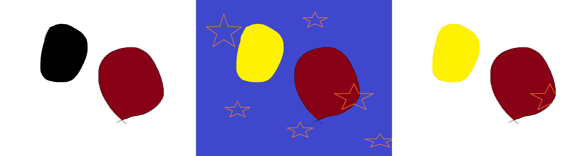
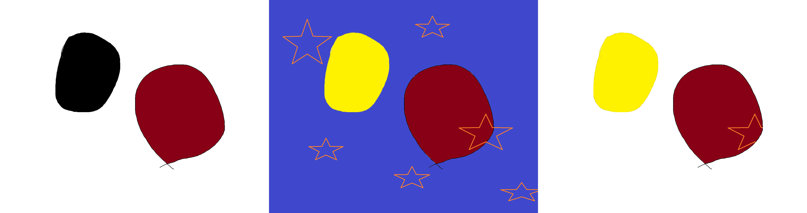
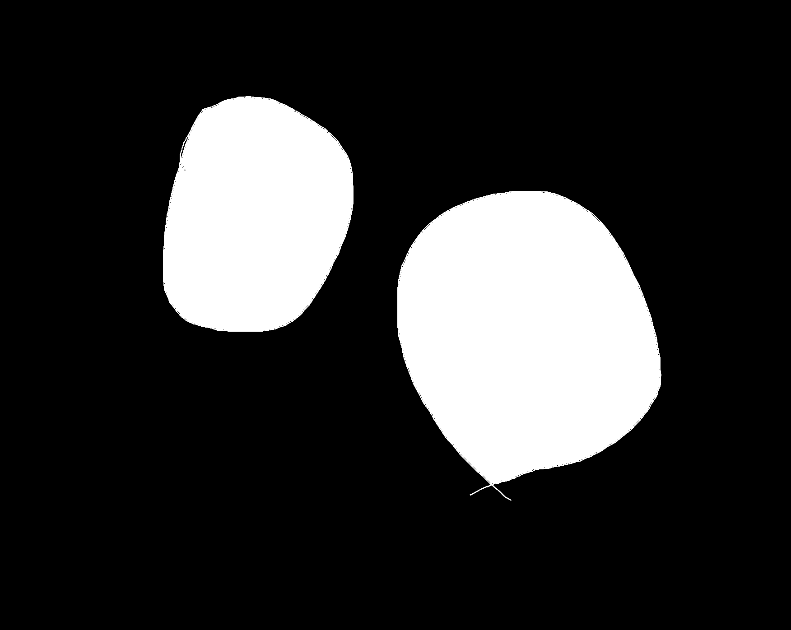

# Лабораторная работа № 1

**Вариант 5.** Замена областей изображения, попадающих в заданный пользователем диапазон цвета, соответствующими областями второго изображения.

## 1. Теоретическая база

используется пространство RGB

Пользователь задаёт нижнюю границу `L = (Lr, Lg, Lb)` и верхнюю границу `U = (Ur, Ug, Ub)`. Пиксель `A(x, y) = (R, G, B)` выбирается для замены, если одновременно выполняются условия:

```text
Lr <= R <= Ur
Lg <= G <= Ug
Lb <= B <= Ub
```

Границы включены в диапазон. Проверка всех каналов соответствует поведению cv2.inRange

Результат проверки записывается в маску `M`: значение 255 означает замену, значение 0 — сохранение исходного пикселя. Итоговое изображение формируется по правилу:

```text
C(x, y) = B(x, y), если M(x, y) = 255
C(x, y) = A(x, y), если M(x, y) = 0
```

Здесь `A` — исходное изображение, `B` — изображение для подстановки.
## 2. Описание разработанной системы

Программа находится в [main.py](main.py). NumPy используется для хранения изображений в массивах. В ручной реализации проверка цвета и замена пикселей выполняются циклами Python без готовых функций выделения цвета.

| Функция | Назначение |
|---|---|
| `read_image` | Чтение изображения и перевод из BGR в RGB |
| `save_image` | Сохранение результата в PNG |
| `chroma_key_opencv` | Построение маски через `cv2.inRange` и перенос пикселей через `cv2.copyTo` |
| `chroma_key_python` | Проверка трёх каналов и замена каждого выбранного пикселя вручную |
| `benchmark` | Прогрев и повторные измерения времени алгоритма |
| `main` | Обработка аргументов, подготовка изображений, сравнение и сохранение результатов |

Обе реализации получают одинаковые изображения и границы цвета. Второе изображение заранее приводится к ширине и высоте первого через `cv2.resize`. При разных пропорциях оно растягивается. Готовые результаты и маски проверяются на полное совпадение через `np.array_equal`.

Реализация
```
def chroma_key_opencv(foreground, background, lower, upper):
    mask = cv2.inRange(foreground, np.array(lower, dtype=np.uint8),
                       np.array(upper, dtype=np.uint8))
    result = foreground.copy()
    cv2.copyTo(background, mask, result)
    return result, mask


def chroma_key_python(foreground, background, lower, upper):
    height, width = foreground.shape[:2]
    result = foreground.copy()
    mask = np.zeros((height, width), dtype=np.uint8)
    for y in range(height):
        for x in range(width):
            red, green, blue = foreground[y, x]
            if (lower[0] <= red <= upper[0]
                    and lower[1] <= green <= upper[1]
                    and lower[2] <= blue <= upper[2]):
                result[y, x] = background[y, x]
                mask[y, x] = 255
    return result, mask
```
### запуск

```powershell
python main.py a.png b.png --lower 240 240 240 --upper 255 255 255 --repeats 5
```

| Аргумент | Значение |
|---|---|
| `foreground` | Путь к исходному изображению, первый позиционный аргумент |
| `background` | Путь к изображению для подстановки, второй позиционный аргумент |
| `--lower R G B` | Нижняя граница RGB, по умолчанию `0 100 0` |
| `--upper R G B` | Верхняя граница RGB, по умолчанию `120 255 120` |
| `--output` | Папка результатов, по умолчанию `results` |
| `--repeats` | Число измерений каждого алгоритма, по умолчанию 5 |
## 3. Результаты работы и тестирования

### Замена цвета

Использованы два изображения размером **1752 × 1396 пикселей**:

- [a.png](a.png) — чёрная и бордовая фигуры на белом фоне;
- [b.png](b.png) — жёлтая и бордовая фигуры на синем фоне.

Выбран диапазон от `(240, 240, 240)` до `(255, 255, 255)`. В него входят белые и близкие к белому пиксели первого изображения.

Слева направо: исходное изображение, изображение для подстановки, результат.


python main.py a.png b.png --lower 200 200 200 --upper 255 255 255 --repeats 1

python main.py a.png b.png --lower 0 0 0 --upper 255 50 50 --repeats 1




### Проверка корректности

При проверке установлено:

- результаты OpenCV и Python совпадают;
- маски обеих реализаций совпадают;

Файлы с результатами: [OpenCV](results/result_opencv.png), [Python](results/result_python.png).

### Сравнение быстродействия

Среда измерений: Windows 11, Python 3.14.5, OpenCV 5.0.0, NumPy 2.5.4.

Перед измерениями каждая реализация выполняется один раз для прогрева. Затем выполняются пять измерений через [`time.perf_counter`](https://docs.python.org/3/library/time.html#time.perf_counter). В замер входит весь вызов функции алгоритма: создание маски, копирование исходного изображения и замена выбранных пикселей.

Сохранённые данные находятся в [results/timings.csv](results/timings.csv).

| Запуск | OpenCV, мс | Python, мс |
|---|---:|---:|
| 1 | 9,348 | 6797,238 |
| 2 | 10,691 | 6846,596 |
| 3 | 10,776 | 6931,246 |
| 4 | 10,245 | 7251,496 |
| 5 | 9,651 | 7101,811 |
| **Медиана** | **10,245** | **6931,246** |
| **Минимум** | **9,348** | **6797,238** |

Ускорение вычислено как отношение медианного времени Python к медианному времени OpenCV. По исходным значениям без округления оно составляет **676,6 раза**.
сложность алгоритма оптимальна но при этом скорость меньше, вероятно изза долгих операций работы с массивами

## 4. Выводы по работе

Реализован Chroma key с пользовательским диапазоном RGB двумя способами. Обе реализации формируют одинаковые маски и изображения.

В проведённом эксперименте OpenCV обрабатывает изображение примерно за 10 мс, а ручная реализация Python — за 6,9 с. Ускорение по медианам составляет около 677 раз.
## 5. Использованные источники

1. [OpenCV: выделение цвета с помощью inRange](https://docs.opencv.org/4.x/da/d97/tutorial_threshold_inRange.html).
2. [OpenCV: операции над массивами, inRange и copyTo](https://docs.opencv.org/4.x/d2/de8/group__core__array.html).
3. [Python: time.perf_counter](https://docs.python.org/3/library/time.html#time.perf_counter).
